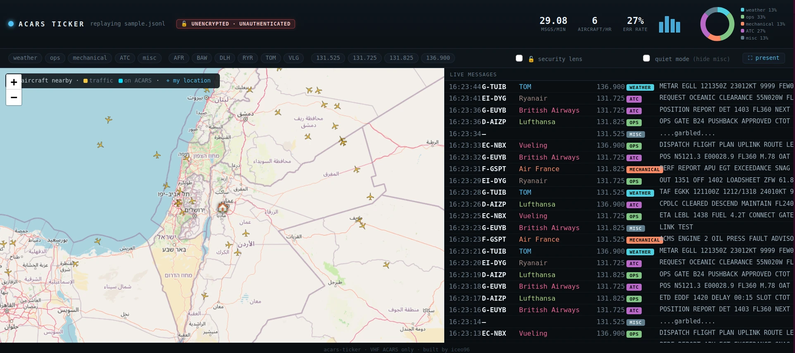

# acars-ticker

A live web dashboard that decodes **VHF ACARS** text messages from aircraft
near you with an RTL-SDR, and displays them as a scrolling feed enriched with
each aircraft's identity and position from a public ADS-B API.



Looks like an airport ops room: dark terminal aesthetic, monospace, colour-coded
airlines, a per-hour message-mix donut, and live per-channel activity bars. The
main view is a **live map** centred on your location with a plane marker per
aircraft (click one for its details and message thread) **beside the scrolling
message feed**.

> `acarsdec` does the radio (MSK demodulation of up to 4 channels from one
> dongle). This project is the **pipeline, storage, enrichment, and UI** around
> it. No ADS-B receive hardware is used — identity/position come from a free
> public API, read-only and cached.

— built by **iceo96**

---

## Scope

**Does:** VHF ACARS only, decode → store → enrich → serve, localhost, no auth.

**Does not** (by design): reimplement MSK demod, receive ADS-B, do HFDL/VDL2/
Inmarsat, add accounts/auth, or over-engineer the map.

---

## Repo layout

```
acars-ticker/
├── acars_ticker/
│   ├── __main__.py        # CLI: live | --replay | --scan | --prune
│   ├── config.py          # ~/.config/acars-ticker.ini loader + defaults
│   ├── collector.py       # launch acarsdec, receive UDP JSON, retry w/ backoff
│   ├── pipeline.py        # classify → store → broadcast → enrich (shared)
│   ├── storage.py         # SQLite (WAL), 30-day retention
│   ├── enrichment.py      # adsb.lol/adsb.fi v2 lookup + 10-min TTL cache
│   ├── classify.py        # label + regex → weather|ops|mechanical|ATC|misc
│   ├── airlines.py        # ICAO operator code → name + stable colour
│   ├── scan.py            # rtl_power sweep → ranked channels → config block
│   ├── replay.py          # feed stored JSONL through the same pipeline
│   ├── server.py          # FastAPI + WebSocket + REST
│   └── web/               # single-page UI (index.html, app.js, style.css)
├── config/acars-ticker.ini.example
├── systemd/acars-ticker.service
├── samples/sample.jsonl   # 15 realistic messages for radio-free testing
├── pyproject.toml / requirements.txt
└── README.md
```

---

## First 10 minutes (zero → your first decoded message)

### 0. Prerequisites

- RTL-SDR dongle (RTL2832U / R820T2), plugged in.
- Linux (Debian/Kali), Python 3.11+.
- `acarsdec` installed and on your PATH, plus `rtl-sdr` tools (`rtl_power`,
  `rtl_test`). On Debian/Kali, `rtl-sdr` is packaged; `acarsdec` you typically
  build from source (https://github.com/TLeconte/acarsdec).

Quick dongle check:

```bash
rtl_test -t          # should list your RTL2832U; Ctrl-C to stop
```

### 1. Install acars-ticker

```bash
cd ~/Desktop/Air-Bas          # this repo
python3 -m venv .venv
source .venv/bin/activate
pip install -r requirements.txt
```

### 2. See it work *without the radio* (recommended first)

Replay the bundled sample through the real pipeline and open the UI:

```bash
python -m acars_ticker --replay samples/sample.jsonl --replay-loop
```

Open **http://127.0.0.1:8080** — you'll see the ticker fill, buckets colour-code,
the donut populate, and clicking a row opens the map + thread panel. This proves
your install before any RF troubleshooting. (`--replay-loop` keeps it flowing.)

### 3. Find your best channels

```bash
python -m acars_ticker --scan
```

This runs `rtl_power` across 130–137 MHz, ranks ACARS channels by power, and
prints a ready-to-paste `[radio]` block. Busiest hubs light up 131.725 /
131.825 in Europe; in the US try 130.025 / 131.550.

### 4. Write your config

```bash
mkdir -p ~/.config
cp config/acars-ticker.ini.example ~/.config/acars-ticker.ini
# paste the channels --scan suggested, set your ppm/gain if known
```

### 5. Go live

```bash
python -m acars_ticker
```

This launches:

```
acarsdec -r 0 131.525 131.725 131.825 136.900 -j -N 5555
```

(derived from your config), listens for its JSON datagrams on UDP 5555, and
serves the dashboard. Reopen **http://127.0.0.1:8080**. ACARS is bursty — a
quiet band can be minutes between messages, so leave it running. The top-left
dot goes **green** when acarsdec is up; if the dongle is yanked it turns red and
a **RECEIVER DOWN** banner appears while the collector retries with backoff.

That's it — first decoded message is usually within a few minutes near any
airport or airway.

---

## Running it as a service

Auto-start on boot, restart on failure, logs to journald:

```bash
mkdir -p ~/.config/systemd/user
cp systemd/acars-ticker.service ~/.config/systemd/user/
# edit WorkingDirectory + ExecStart paths inside the unit
systemctl --user daemon-reload
systemctl --user enable --now acars-ticker
journalctl --user -u acars-ticker -f
```

(A system-wide variant and the RTL-SDR `plugdev` note are in the unit's header.)

---

## Config file format

`~/.config/acars-ticker.ini` — every value is optional and falls back to
European defaults. Full annotated template: [`config/acars-ticker.ini.example`](config/acars-ticker.ini.example).

| Section        | Key              | Meaning                                              |
|----------------|------------------|------------------------------------------------------|
| `[radio]`      | `device_index`   | RTL-SDR index (first dongle = 0)                     |
|                | `ppm`            | frequency correction for your dongle                 |
|                | `gain`           | dB, or `auto`                                        |
|                | `channels`       | up to 4 MHz freqs, comma/space separated             |
|                | `udp_port`       | acarsdec → collector UDP port (default 5555)         |
|                | `acarsdec_bin`   | path to acarsdec if not on PATH                      |
| `[storage]`    | `db_path`        | SQLite file                                          |
|                | `retention_days` | prune older rows (default 30)                        |
| `[enrichment]` | `provider`       | `adsb.lol` or `adsb.fi`                              |
|                | `cache_seconds`  | per-reg lookup TTL (default 600 = 10 min)            |
| `[web]`        | `host` / `port`  | bind address (default 127.0.0.1:8080)                |
| `[scan]`       | `range`          | rtl_power sweep, e.g. `130M:137M:25k`                |

---

## Your location & the live map

On launch the dashboard opens the map centred on your **home** location and
draws a 🏠 receiver marker there. Each aircraft that ADS-B has a position for
gets a ✈ marker (coloured by airline); clicking it opens a popup with its type,
frequency, altitude, latest message and an **open thread →** link. The map
auto-frames your planes on first load, and the **⌖ my location** button
recenters on you.

Home comes from the `[location]` config section (pre-filled with the operator's
pin near Amman, Jordan — change `lat`/`lon` to yours). If `geolocate = true`
(default), the browser also asks once to use your real position and recenters
the map on it. No position data ever leaves your machine.

```ini
[location]
lat = 31.962958
lon = 35.812154
zoom = 8
geolocate = true
```

## Message classification

Each message is bucketed by its 2-char ACARS label plus text regexes
(text wins, being more specific):

- **weather** — METAR / SPECI / TAF / ATIS / RVR replies and requests
- **ops** — gate, pushback, ETA/ETD, OOOI, loadsheet, crew, connections
- **mechanical** — fault/maintenance/ECAM/exceedance/snag text
- **ATC** — CPDLC clearances, oceanic/position reports, SELCAL
- **misc** — everything else (hidden by **quiet mode**)

---

## CLI reference

```
python -m acars_ticker                      live: acarsdec + web UI
python -m acars_ticker --replay FILE.jsonl  offline replay (no radio)
        [--replay-speed 2.0] [--replay-loop]
python -m acars_ticker --scan [--scan-time 30]   rank active channels
python -m acars_ticker --prune              drop rows past retention, exit
python -m acars_ticker --host 0.0.0.0 --port 8080 -c /path/to.ini -v
```

---

## Capturing your own replay file

The UDP datagrams acarsdec emits are JSON lines — capture them straight to a
file while live to build your own test corpus:

```bash
acarsdec -r 0 131.725 131.825 -j -N 5555 &
nc -ul 5555 > my_capture.jsonl
# later, radio-free:
python -m acars_ticker --replay my_capture.jsonl
```

---

## Notes & limits

- Enrichment is best-effort: if an aircraft isn't currently on ADS-B, you still
  get the raw registration — the feed never blocks on a lookup.
- ADS-B position is "last known when queried", not the exact transmit position
  (no hardware receive). The side panel labels it as such.
- Localhost only, no auth — don't expose the port to a network you don't trust.
